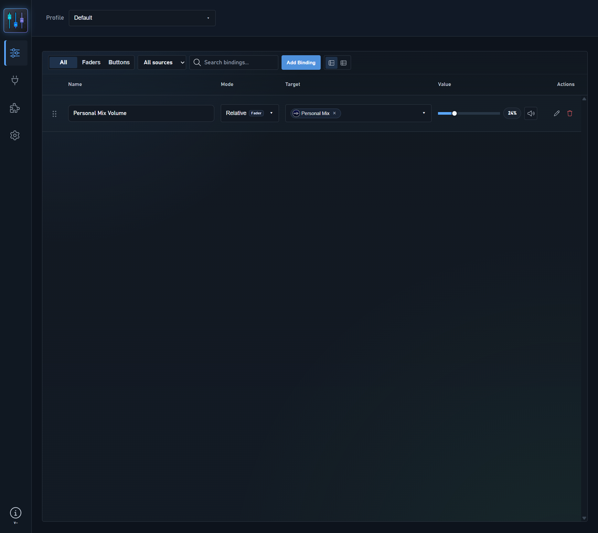

# InputMaster

https://inputmaster.app/



InputMaster is a Windows desktop app for mapping MIDI, keyboard, and controller
inputs to system audio, app audio sessions, audio devices, utility actions
like hotkeys and AutoHotkey scripts, and supported integrations via bundled and third-party plugins.

## Credits

InputMaster is a fork of [MIDIMaster](https://github.com/prgmitchell/MIDIMaster) by **Yolo** (prgmitchell). Thank you for the solid foundation — profiles, bindings, MIDI/controller capture, plugins, and the updater architecture this fork builds on.

This fork is maintained by **Rick van Modem**, with substantial implementation help from **Cursor Auto**. It is an independent fork; it is not affiliated with, endorsed by, or sponsored by Yolo / MIDIMaster upstream.

## What’s different in this fork

- Product rename to **InputMaster** (`InputMaster.exe`, v1.0.0, AppData under InputMaster)
- Updater feed only on `https://updates.inputmaster.app/latest.json` (no midimaster.app fallback)
- Inputs IA refresh: clearer MIDI / keyboard / controller surfaces, enable toggles, Learn copy
- UI consistency pass: shared type scale, 1px borders, Appearance editor polish
- Fork packaging: signed 1.0 NSIS for the InputMaster feed; MIDIMaster website publish disabled

## Platform

InputMaster currently supports Windows.

## Switch between headphones and speakers

On a button binding, select your headphones under **Playback Devices** and choose
**Set Default Device**. Add your speakers to the same binding with the same action.
Each press switches to the next selected device; releasing the button does nothing.
Devices cycle in selection order, skipping disconnected devices. A single selected
device always becomes the default. Recording devices cycle separately, so a button
can still set both a playback device and a microphone.

## Plugins and the Store

InputMaster supports runtime plugins and an in-app Store for integrations. Plugins
can add binding targets, connection UI, runtime behavior, and feedback updates
without rebuilding the app.

## Trademarks and attribution

Third-party product names, trademarks, and logos are property of their respective owners and are
used for identification purposes only.

This project is not affiliated with, endorsed by, or sponsored by VB-Audio, OBS Project, Elgato, Signify, Discord,
or any other third-party vendor.

Some third-party logos are included in this repository and shown in the UI (for example in the
bundled integration plugins) purely to help users recognize the integration they are configuring.
If you are a trademark owner and would like a logo removed or adjusted to comply with brand
guidelines, please open an issue.

## Development

This repo is a Tauri v2 app. The frontend is plain static HTML/CSS/JS (no Node build step).

Prerequisites:

- Rust (stable) and Cargo
- Visual Studio Build Tools / MSVC toolchain
- Tauri CLI v2 (`cargo install tauri-cli --version "^2" --locked`)

Clone and run the app:

```powershell
git clone https://github.com/fu-raz/InputMaster.git
cd InputMaster
cargo tauri dev
```

Build a local Windows bundle:

```powershell
cargo tauri build
```

Updater feed: `https://updates.inputmaster.app/latest.json`

## Verification

With Node 22+, Rust/MSVC and WebView2 installed on Windows:

```powershell
npm ci
npm test
```

`npm test` builds and drives the real desktop app and an isolated virtual-audio
service. It uses separate application data and private network/pipe endpoints.
Results and failure evidence are saved under `test-results/desktop-<timestamp>/`.
Physical hardware, live vendor integrations and installer workflows still require
release validation.

When editing bundled plugins, change their `src/` modules and run `npm run build:plugins`
to regenerate the checked-in `plugin.mjs` files. `npm run check:plugins` checks that
those bundles match their sources.

## License

MIT. See `LICENSE`.
